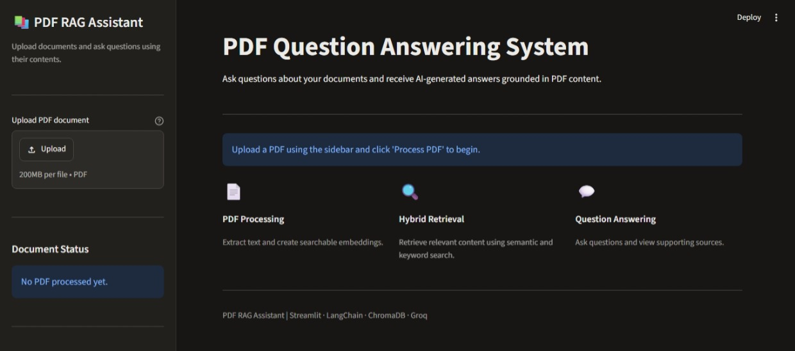
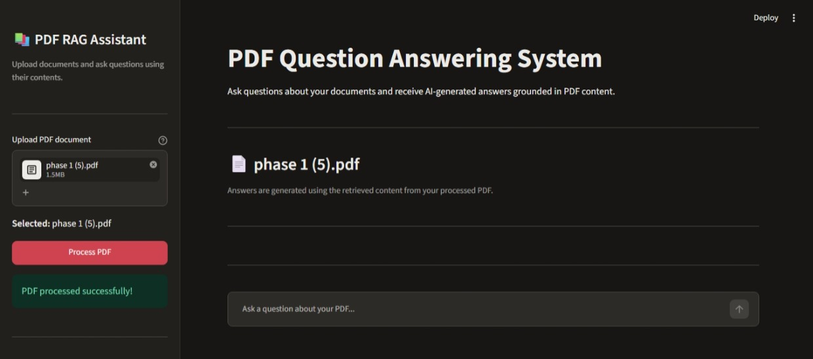
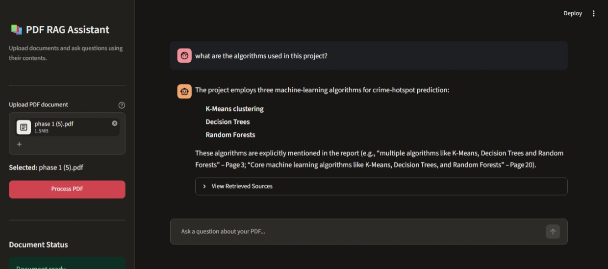
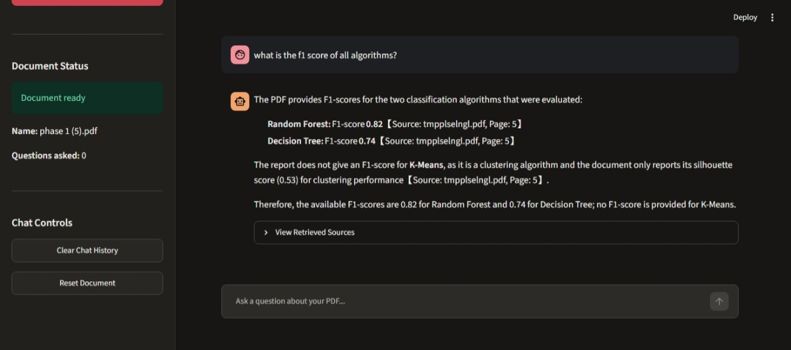
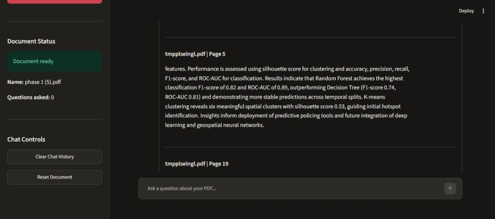
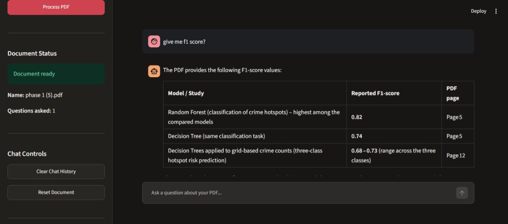
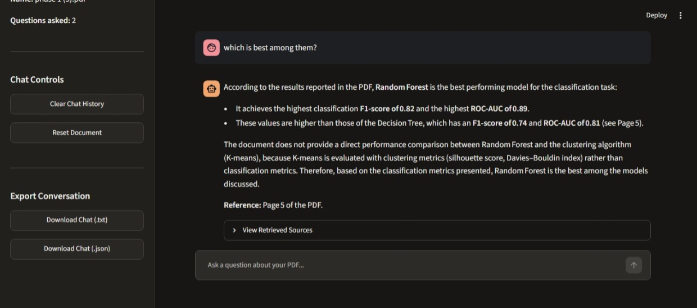
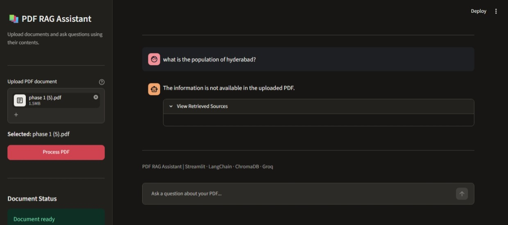

# RAG-Based PDF Question Answering System

## Project Overview

The RAG-Based PDF Question Answering System is an intelligent document question-answering application that allows users to upload PDF documents and ask questions about their content.

The system uses Retrieval-Augmented Generation (RAG) to retrieve relevant information from uploaded documents and generate context-grounded answers using a Large Language Model (LLM). It combines semantic search and keyword search using Reciprocal Rank Fusion (RRF) to improve retrieval quality.

## Features

- PDF document upload and text extraction
- Text chunking with overlapping chunks
- Semantic search using vector embeddings
- Keyword-based retrieval
- Hybrid retrieval using Reciprocal Rank Fusion (RRF)
- Question rewriting using conversation history
- Context-grounded answer generation
- Source passages with page references
- Follow-up questions with chat history
- Chat history management
- Conversation export in TXT and JSON formats
- Retrieval evaluation
- LLM answer evaluation
- Interactive Streamlit interface

## Technologies Used

- Python
- Streamlit
- LangChain
- Groq API
- ChromaDB
- HuggingFace Sentence Transformers
- PyMuPDF
- python-dotenv

## Models Used

**Embedding Model:**  
sentence-transformers/all-MiniLM-L6-v2

**Language Model:**  
openai/gpt-oss-120b using Groq API

## System Architecture

```text
PDF Upload
    |
    v
PDF Text Extraction
    |
    v
Text Chunking
    |
    v
Text Embeddings
    |
    v
ChromaDB Vector Storage
    |
    v
User Question
    |
    v
Question Rewriting
    |
    v
Hybrid Retrieval
    |
    +--------------------+
    |                    |
    v                    v
Semantic Search     Keyword Search
    |                    |
    +--------------------+
             |
             v
Reciprocal Rank Fusion
             |
             v
Relevant Document Chunks
             |
             v
Groq LLM
             |
             v
Context-Grounded Answer
             |
             v
Answer with Source References
             |
             v
Streamlit Interface
```

## Project Structure

```text

RAG-Based PDF Question Answering System/
│
├── data/
│   ├── uploaded_pdfs/
│   └── vectorstore/
│
├── reports/
│   └── chat_conversation.txt
│
├── screenshots/
│   ├── application_home.jpeg
│   ├── pdf_processing_completed.jpeg
│   ├── question_answering.jpeg
│   ├── answer_with_sources.jpeg
│   ├── follow_up_question.jpeg
│   ├── f1_score_answer.jpeg
│   ├── unavailable_answer.jpeg
│   └── conversation_history.jpeg
│
├── src/
│   ├── __init__.py
│   ├── embeddings.py
│   ├── pdf_loader.py
│   ├── rag_pipeline.py
│   ├── text_splitter.py
│   └── vector_store.py
│
├── tests/
│   ├── test_embeddings.py
│   ├── test_pdf_loader.py
│   ├── test_rag.py
│   ├── test_retrieval.py
│   ├── test_text_splitter.py
│   └── test_vector_store.py
│
├── notebooks/
│
├── .env
├── .env.example
├── .gitignore
│
├── answer_evaluation_dataset.py
├── answer_evaluation_results.csv
├── app.py
├── evaluate_answers.py
├── README.md
└── requirements.txt

```

## Installation and Setup

## Clone Repository

```bash
git clone https://github.com/Anil-Vana/RAG-Based-PDF-Question-Answering.git
cd RAG-Based-PDF-Question-Answering
```


### 2. Create Virtual Environment

```bash
py -3.12 -m venv .venv
```

### 3. Activate Virtual Environment

Windows PowerShell:

```powershell
.venv\Scripts\Activate.ps1
```

Windows Command Prompt:

```cmd
.venv\Scripts\activate
```

### 4. Install Dependencies

```bash
pip install -r requirements.txt
```

### 5. Configure Environment Variables

Create a `.env` file in the project root directory.

```env
GROQ_API_KEY=your_groq_api_key
GROQ_MODEL=openai/gpt-oss-120b
```

Replace the placeholder with your actual Groq API key.

Do not upload your `.env` file or API key to public repositories.

### 6. Run the Application

```bash
streamlit run app.py
```

The application will start locally, and Streamlit will display the application URL in the terminal.

## How to Use

1. Launch the Streamlit application.
2. Upload a PDF document using the sidebar.
3. Click Process PDF.
4. Wait until PDF processing is completed.
5. Enter a question related to the uploaded document.
6. View the generated answer.
7. Open View Retrieved Sources to inspect supporting passages and page references.
8. Ask follow-up questions using the chat interface.
9. Export conversation history as TXT or JSON.
10. Clear chat history or reset the document when required.

## Screenshots

### Application Home


### PDF Processing



## Question Answering 


### Question Answering of Sources



### Question Answering with Sources



### Follow-up Question





### Information Not Available in PDF



## Evaluation Results

### Retrieval Evaluation

Hybrid retrieval was evaluated using 5 sample questions.

| Metric | Result |
|---|---:|
| Hit Rate @ 5 | 100% |
| Hit Rate @ 10 | 100% |

### Answer Evaluation

LLM-generated answers were evaluated using 5 sample questions.

| Metric | Result |
|---|---:|
| Passing Answers | 5/5 |
| Evaluation Pass Rate | 100% |

Note: Evaluation results are based on a small sample dataset and do not guarantee performance on all documents or questions.

## Limitations

- Scanned PDFs may require OCR.
- Answer quality depends on PDF extraction and retrieval quality.
- Complex tables and images may not be extracted accurately.
- Evaluation dataset is limited.
- Groq API and internet connectivity are required for answer generation.

## Future Enhancements

- OCR support for scanned PDFs
- Multi-PDF document support
- Advanced document reranking
- Improved retrieval evaluation
- Better table extraction
- Cloud deployment


